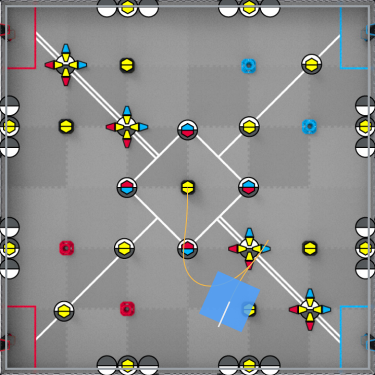
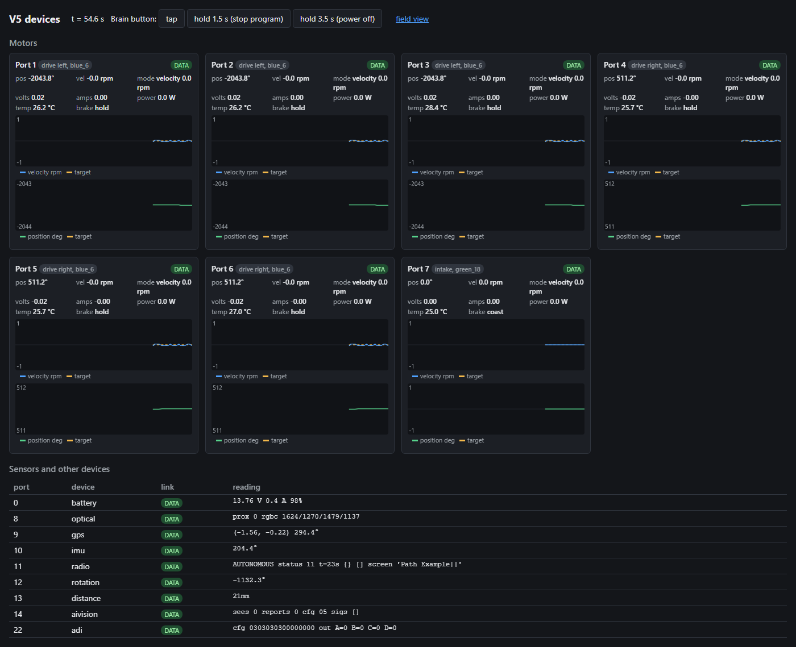

# V5 Simulacrum

*Mente simulata.* UNSW Robotics Competition Club's VEX V5 brain simulator. Unofficial; not affiliated with VEX.

A full-system simulator for the VEX V5 Brain. QEMU runs the brain's real VEXos 1.1.5.0 firmware on an emulated Zynq-7000. A Python robot simulator sits on its smart ports. Programs built for a real V5 run unchanged: VEXcode C++, VEXcode Python, PROS and vexide. You upload them with the usual tools over an emulated USB port.

<p align="center">
  
  
</p>

What you get:

- the brain's screen in a window, with touch and the front button;
- a simulated robot: motors, drivetrains (tank, X-drive, mecanum), IMU, distance, optical, GPS, AI Vision, legacy Vision, rotation, 3-wire devices, radio and controllers;
- a field view and device dashboard in the browser (http://localhost:8765/), driven from the keyboard or a gamepad;
- the brain screen, field view and dashboard inside VS Code, with a port map editor for the robot ([v5-simulacrum-vscode](https://github.com/UNSW-Robotics-Competition-Club/v5-simulacrum-vscode));
- a field-control page that runs timed matches and skills runs, for testing competition code and UI (`V5Sim ui-test program.bin`);
- timed matches through field control, game blocks and goals, and optional MuJoCo physics;
- USB upload and terminal: VEXcode and PROS see it as a plugged-in brain (via usbip-win2), or use WSL serial ports;
- headless batch runs that score an autonomous routine (`scripts/v5run.py`);
- on-device GDB debugging with vexide/v5gdb.

## Requirements

- **Windows 10/11 with WSL 2 and Ubuntu 24.04** (`wsl --install -d Ubuntu-24.04`, then open it once to create your user). Setup and the launchers only work there for now. To use a distro with another name, set `V5SIM_DISTRO` for `V5Sim` and use that name in the `wsl -d` commands.
- About 3 GB free in WSL for QEMU, the Arm toolchain and the MuJoCo venv.
- Optional: the VEXcode VS Code extension (builds the VEXcode test programs), usbip-win2 (makes the sim show up as a USB brain on Windows).

## Quick start

```sh
git clone https://github.com/UNSW-Robotics-Competition-Club/v5-simulacrum.git
cd v5-simulacrum
wsl -d Ubuntu-24.04 -- bash scripts/setup.sh   # firmware, QEMU + VEX models, Arm toolchain, MuJoCo venv
```

The repo doesn't include VEX's firmware. `setup.sh` runs `scripts/fetch_firmware.sh`, which downloads VEXos 1.1.5.0 from VEX's public download server (the same one the VEXcode extension uses), checks it against a known SHA-256 hash and unpacks it into `extracted/`.

```bat
V5Sim                                       :: drivetrain robot, no program
V5Sim competition path\to\program.bin       :: full sensor robot running your program
V5Sim ui-test path\to\program.bin           :: on a field controller, disabled: test your UI code
V5Sim start competition                     :: run in the background; V5Sim list / log / stop
```

Prerequisites, presets, robot options, uploading, matches and troubleshooting are in **[SIMULATOR.md](SIMULATOR.md)**.

## Documentation

| doc | for |
|---|---|
| [SIMULATOR.md](SIMULATOR.md) | user guide: running, robot options, USB, GDB, limits |
| [docs/DEVELOPMENT.md](docs/DEVELOPMENT.md) | developer notes: layout, tests, rebuilding QEMU |
| [sdk/README.md](sdk/README.md) | the C SDK for plain-C test programs |

## Repo layout

| path | what |
|---|---|
| `V5Sim.cmd` | Windows launcher |
| `qemu-vex/` | QEMU machines `vex-v5` (the brain) and `vex-motor` (a smart motor's LPC824), their device models, plus patches on QEMU v11.1.2 |
| `sim/` | robot simulator (`v5sim/`), presets (`robots/*.args`) and unit tests |
| `scripts/` | `v5brain.sh` (main entry), `v5fleet.sh` (instance manager), `setup.sh`, `fetch_firmware.sh`, end-to-end checks (`*_test.sh`, `e2e_all.sh`) |
| `programs/` | test programs and their build scripts |
| `extracted/` | VEXos 1.1.5.0, unpacked by `fetch_firmware.sh` (not in git) |
| `sdk/` | C/C++ SDK headers and stubs |

## Tests

```sh
cd sim && ~/venvs/sim/bin/python -m pytest -q tests   # unit tests (~8 s)
bash scripts/e2e_all.sh                               # end-to-end: boots VEXos, runs real programs (~15 min)
```

See [docs/DEVELOPMENT.md](docs/DEVELOPMENT.md) for what each check covers.

## Cautions

- Run sims only through `V5Sim` / `V5Sim start|stop`. Stop them gracefully, never by killing QEMU or WSL. The usbip-win2 driver can bugcheck Windows on an ungraceful USB detach (SIMULATOR.md, section 5).
- Run one USB/IP-attached brain at a time. Further instances fall back to WSL serial ports.

## License

The simulator is **LGPL-3.0-or-later**: you can use it, bundle it or drive it from other tools (an editor extension, a team dashboard) under any license, and changes to the simulator itself stay open. Three directories differ:

- `qemu-vex/` (QEMU device models and patches): GPL-2.0-or-later, like QEMU.
- `sdk/` (C SDK generated from vexide's vex-sdk): MIT.
- `programs/` (example and template robot programs): MIT-0, so you can copy them into your own robot code without keeping a notice.

See [NOTICE](NOTICE) for which license covers what, [LICENSE](LICENSE) for the LGPL text, and [THIRD_PARTY.md](THIRD_PARTY.md). Contributions are accepted under the license of the directory they change.

VEX, V5 and VEXos are trademarks of Innovation First, Inc. This project isn't affiliated with or endorsed by VEX Robotics. It doesn't redistribute VEX firmware: you download it from VEX with `scripts/fetch_firmware.sh`.
